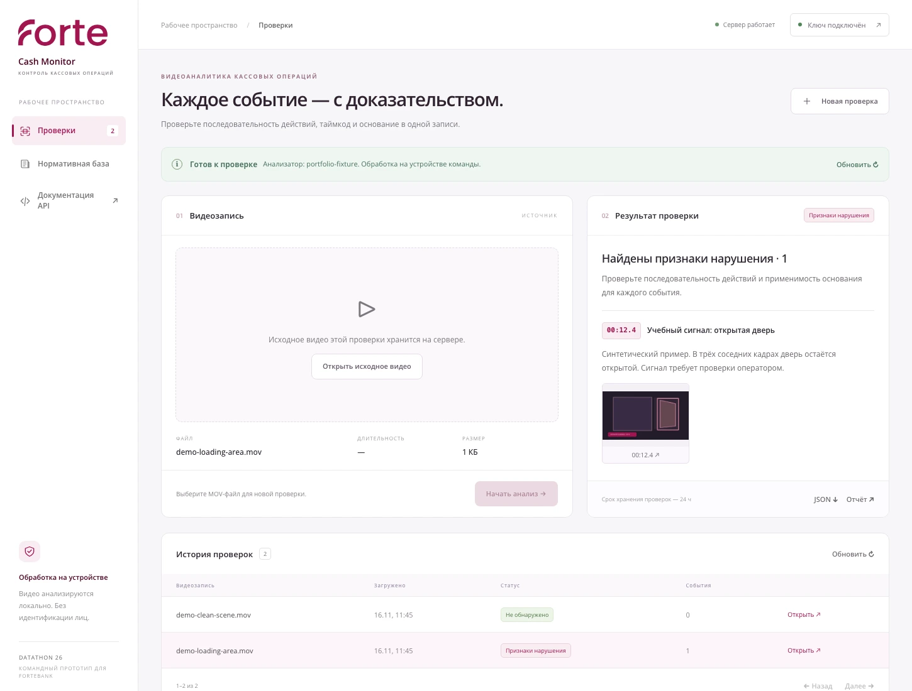
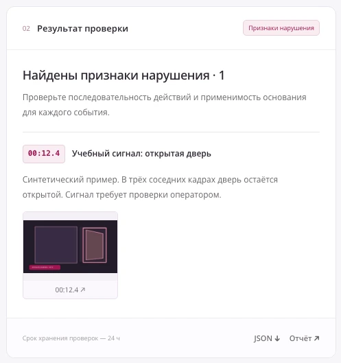

<div align="center">

# Forte Cash Monitor

**Видеоаналитика кассовых операций для специалиста по контролю**

`DATATHON ’26 · ФИНАЛИСТЫ` &nbsp; · &nbsp; `LOCAL AI` &nbsp; · &nbsp; `HUMAN REVIEW`

[Интерфейс](#интерфейс) · [Результаты](#результаты) · [Вклад участников](#вклад-участников) · [Запуск](#локальный-запуск)

</div>

На длинной записи с камеры специалисту нужно найти короткий эпизод и понять, почему он заслуживает внимания. Мы собрали прототип, который выдаёт **тип сигнала, таймкод и кадры**, чтобы проверяющий мог быстро вернуться к эпизоду и сверить контекст. Проект вышел в финал Datathon ’26 по кейсу ForteBank. Это командная работа для хакатона; проект не является официальным продуктом банка.



## Интерфейс

Рабочее пространство объединяет загрузку MOV, предпросмотр, историю проверок и экспорт. В карточке события таймкод связан с плеером, кадр открывается в увеличении, а результат можно выгрузить в JSON или HTML. Для интеграции предусмотрен асинхронный FastAPI: `POST /api/v1/analyze` → `job_id` → `GET /api/v1/jobs/{job_id}`.



*Скриншоты сделаны в реальном интерфейсе на синтетических записях. Кадр нарисован для демонстрации; исходных роликов и персональных данных здесь нет.*

## Как устроена финальная сборка

```text
Видео → очередь задач → выбор кадров и признаки сцены
      → локальная Qwen3-VL через llama.cpp → движок правил
      → события с таймкодами и кадрами → ручная проверка
```

В финальной сборке модели компьютерного зрения находят людей и ориентиры сцены; локальная визуально-языковая модель проверяет отдельные признаки по кадрам. Движок правил связывает наблюдение с категорией, а специалист может подтвердить или отклонить событие. Это сигнал для проверки: по одному ракурсу нельзя надёжно установить все обстоятельства эпизода.

**Какая версия где:** эта ветка показывает исходное рабочее пространство и контракт подключения анализатора. [Финальная сборка команды](https://github.com/gojosatorukz/forte-cash-monitor/tree/7193987258598a4ff7ff5a331dccb5c7e0eba2df) содержит отдельный веб-сервис с локальным детектором, ручной проверкой и печатным актом. [Архитектура финальной сборки](https://github.com/gojosatorukz/forte-cash-monitor/blob/7193987258598a4ff7ff5a331dccb5c7e0eba2df/docs/deliverables/02_arhitektura.md).

## Результаты

Внутренняя оценка команды на 42 роликах хакатона: 22 положительных и 20 отрицательных. Ниже — результаты финального детектора `8540d83` из [журнала экспериментов](https://github.com/gojosatorukz/forte-cash-monitor/blob/7193987258598a4ff7ff5a331dccb5c7e0eba2df/docs/status_detector.md#L10).

| Вход | Положительные ролики с сигналом | Отрицательные ролики с ложным сигналом |
| --- | ---: | ---: |
| Оригиналы | 21/22 (95%) | 9/20 (45%) |
| Перекодированные копии | 20/22 (91%) | 11/20 (55%) |

Перекодированный набор — те же ролики, поэтому это проверка устойчивости, а не независимая выборка. Финальная конфигурация находила больше положительных эпизодов ценой ложных тревог. Результаты относятся к этому набору; качество на новых камерах они не подтверждают.

## Вклад участников

| Участник | Вклад |
| --- | --- |
| **[Bekzat Rashiduly](https://github.com/gojosatorukz) · AI Engineer** | Интеграция AI на уровне рабочего пространства и контракта подключения анализатора, фронтенд, подготовка питча и демо, поиск похожих видео в открытых источниках. |
| **Zhanybek Baltabay · Backend / Local LLM** | Бэкенд финальной сборки, подключение и запуск локальной модели, подготовка вариантов видеодатасета, включая зеркальное отражение. |
| **Совместно** | Работа над обучением модели и оценкой качества. |

## Локальный запуск

Для просмотра рабочего пространства нужен **Python 3.12**. Команды для macOS/Linux:

```bash
python3.12 -m venv .venv
source .venv/bin/activate
python -m pip install -r requirements-dev.lock.txt
python -m pip install --no-deps -e .
python scripts/init_env.py
python scripts/run.py
```

Откройте [рабочее пространство](http://127.0.0.1:8000) или [документацию API](http://127.0.0.1:8000/docs). Для доступа к истории введите ключ из локального `.env`. Фронтенд можно открыть и предварительно просмотреть файл без модели. Для анализа в этой ветке нужен адаптер по [контракту интеграции](docs/ml_integration.md); пока его нет, сервис показывает, что анализ недоступен. Для запуска **готового пайплайна с локальной VLM** используйте [инструкцию финальной сборки](https://github.com/gojosatorukz/forte-cash-monitor/blob/7193987258598a4ff7ff5a331dccb5c7e0eba2df/docs/deliverables/01_instrukciya_zapusk.md).

Исходные видео, веса моделей и ключи не входят в эту ветку. Временный адрес хакатона для запуска не требуется.

---

**English summary.** Datathon ’26 finalist project: a local AI workflow for reviewing cash-room footage, with timecoded events, visual evidence and human review. This branch contains the portfolio workspace and analyzer integration contract. The archived competition build contains the FastAPI service, computer vision, local Qwen3-VL and rules engine.
